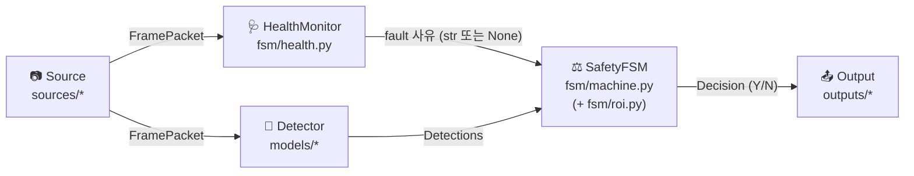
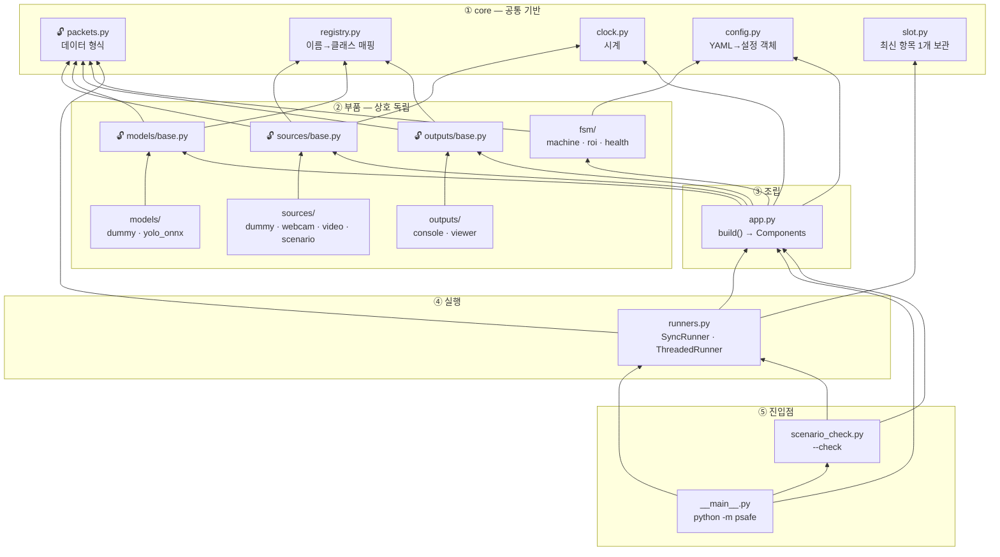
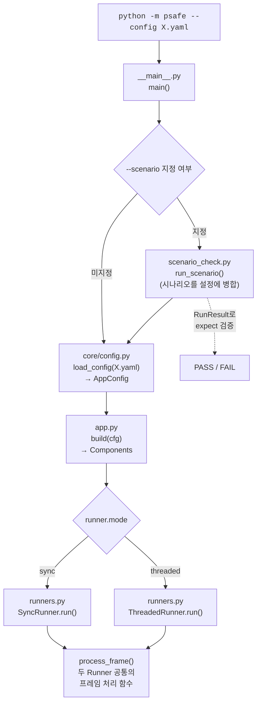
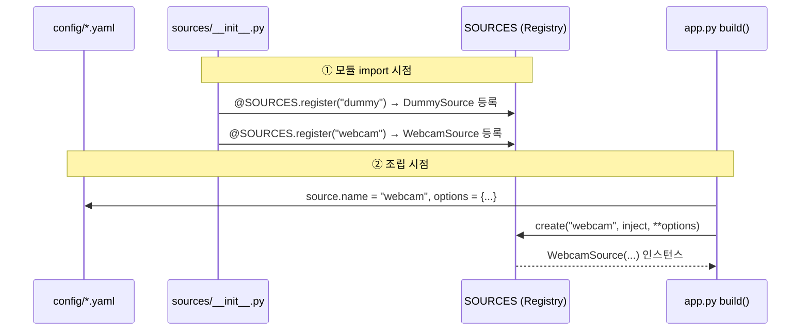
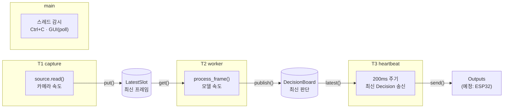
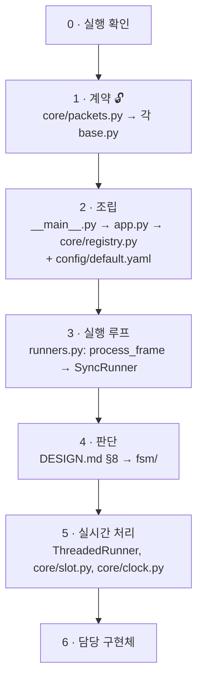

# 코드 구조 안내 (CODE_GUIDE)

> 관련 문서: `docs/DESIGN.md` (설계 배경과 원칙)
> 본 문서는 파일 간 연결 관계와 실행 흐름을 설명한다.
> 다이어그램은 Mermaid 형식이다. GitHub에서는 그대로 렌더링되며, VS Code에서는 "Markdown Preview Mermaid Support" 확장이 필요하다.

---

## 0. 범례

| 표시 | 의미 | 대상 파일 |
|---|---|---|
| 🔓 **계약** | 팀에 공유되는 파일. 모듈 간 **데이터 형식**과 **인터페이스**를 정의한다 | `core/packets.py`, `sources/base.py`, `models/base.py`, `outputs/base.py` |
| 🔨 **구현** | 각 담당자가 구현하는 파일. 본 문서는 입력과 출력만 기술한다 | 그 외 전부 |

모든 부품은 계약(🔓)을 통해서만 상호작용한다. 따라서 개별 구현 내용을 몰라도 전체 흐름을 파악할 수 있다.

---

## 1. 전체 구조

### 1.1 런타임 데이터 흐름

프레임 한 장이 입력되어 Y/N 신호로 출력되기까지의 경로다. 화살표에 표기된 타입은 모두 `core/packets.py`에 정의되어 있다.



- **HealthMonitor**와 **Detector**는 같은 프레임을 독립적으로 처리한다. HealthMonitor는 카메라 상태를, Detector는 사람의 존재 여부를 판단한다.
- **SafetyFSM**은 두 결과를 종합하여 최종 판단을 내린다. 카메라 이상이 감지되면 검출 결과와 관계없이 Y를 출력하지 않는다.
- **Output**은 `Decision`만 입력받으며, 사용된 모델이나 카메라 종류에 의존하지 않는다.

### 1.2 파일 의존 관계

화살표는 import 방향을 나타낸다. 하위 계층은 상위 계층을 참조하지 않으며, `core`는 다른 패키지를 import하지 않는다.



구조상 특징:

1. `sources` · `models` · `outputs` · `fsm`은 서로 import하지 않는다. 한 부품의 변경이 다른 부품에 영향을 주지 않는다.
2. 구체 클래스(웹캠, YOLO 등)를 직접 참조하는 코드는 없다. `app.py`도 레지스트리(`SOURCES`, `DETECTORS`, `OUTPUTS`)만 참조하며, 구체 클래스는 YAML 설정의 이름으로만 지정된다. (§3.2)
3. `runners.py`는 `Components` 객체만 입력받으며, 부품의 구현 종류(가상/실제)와 무관하게 동작한다.

### 1.3 디렉터리 구성

```
src/psafe/
├── __main__.py          ⑤ 진입점. 인자 해석 → 조립 → 실행
├── scenario_check.py    ⑤ 시나리오 실행 및 expect 검증
├── app.py               ③ 설정으로부터 부품 생성, Components로 묶음
├── runners.py           ④ 부품 실행 루프 (Sync / Threaded)
│
├── core/                ① 공통 기반
│   ├── packets.py   🔓  FramePacket · Detection(s) · Decision · State
│   ├── registry.py      이름 → 클래스 매핑
│   ├── config.py        YAML → AppConfig (정의되지 않은 키는 오류)
│   ├── clock.py         RealClock / FakeClock
│   └── slot.py          LatestSlot (스레드 간 최신 프레임 전달)
│
├── sources/             ② 프레임 생성          read() → FramePacket
│   ├── base.py      🔓  Source 인터페이스, SOURCES 레지스트리
│   ├── dummy.py         가상 장면 생성 (시나리오 재생)
│   ├── scenario.py      시나리오 YAML 파싱
│   ├── webcam.py        웹캠 입력
│   └── video.py         영상 파일 입력
│
├── models/              ② 객체 검출            predict(FramePacket) → Detections
│   ├── base.py      🔓  Detector 인터페이스, DETECTORS 레지스트리
│   ├── dummy.py         노이즈를 주입하는 가상 검출기
│   └── yolo_onnx.py     YOLO (ONNX)
│
├── fsm/                 ② 판단 (순수 로직, 입출력 없음)
│   ├── machine.py       SafetyFSM: step(Detections) → Decision
│   ├── roi.py           감시 구역 포함 판정
│   └── health.py        카메라 상태 검사: check(FramePacket) → 사유 또는 None
│
├── outputs/             ② 결과 출력            send(Decision)
│   ├── base.py      🔓  Output 인터페이스, OUTPUTS 레지스트리
│   ├── console.py       로그 출력
│   └── viewer.py        화면 표시 및 녹화
│
└── tools/camcheck.py    카메라 측정 도구 (파이프라인과 독립)
```

---

## 2. 진입점과 실행 흐름

### 2.1 호출 순서



실행 경로는 입력 종류(웹캠, 시나리오, 테스트)와 관계없이 **설정 로드 → 조립(`build`) → 실행(Runner)** 의 3단계로 동일하다.

### 2.2 `Components`

`app.py`의 `build()`가 반환하는 객체로, Runner의 유일한 입력이다.

```
Components
├── cfg       : AppConfig        전체 설정
├── clock     : Clock            RealClock 또는 FakeClock
├── source    : Source           🔓 sources/base.py
├── detector  : Detector         🔓 models/base.py
├── health    : HealthMonitor    fsm/health.py
├── fsm       : SafetyFSM        fsm/machine.py
└── outputs   : list[Output]     🔓 outputs/base.py (복수 가능)
```

---

## 3. 주요 설계 패턴

### 3.1 인터페이스 (ABC)

`base.py`의 클래스는 동작 코드를 거의 포함하지 않는다. 구현체가 지켜야 할 메서드와 반환 타입만 정의한다.

```
Source (인터페이스)     ← Runner가 참조하는 타입
 ├── DummySource
 ├── WebcamSource
 └── VideoFileSource
```

`@abstractmethod`가 붙은 메서드는 모든 구현체가 반드시 구현해야 한다. 구현 파일을 읽기 전에 해당 `base.py`를 먼저 확인하면 각 메서드의 역할을 파악하기 쉽다.

### 3.2 레지스트리

설정 파일의 `name` 값을 실제 클래스로 변환하는 과정이다.



- **등록:** 구현 클래스에 `@SOURCES.register("이름")` 데코레이터를 붙이면 모듈이 import될 때 레지스트리에 등록된다. 각 패키지의 `__init__.py`가 구현 모듈을 import하는 것은 이 때문이며, 새 구현을 추가할 때는 `__init__.py`에도 import를 추가해야 한다.
- **생성:** `create()`는 YAML의 `options`를 생성자 인자로 전달한다. 정의되지 않은 옵션은 생성 시 오류가 발생한다.

설정 항목과 레지스트리의 대응:

| 설정 위치 | 레지스트리 | 등록된 이름 |
|---|---|---|
| `source.name` | `SOURCES` (`sources/base.py`) | `dummy`, `webcam`, `video` |
| `model.name` | `DETECTORS` (`models/base.py`) | `dummy`, `yolo_onnx` |
| `outputs[].name` | `OUTPUTS` (`outputs/base.py`) | `console`, `viewer` |
| `fsm`, `health`, `runner` | 해당 없음 (고정 클래스) | `core/config.py`의 `FsmConfig` 등 |

### 3.3 의존성 주입

`build()`는 실행 중에 결정되는 값(`clock`, `roi`, `person_conf_low`)을 `inject`로 전달한다. 생성자에 **같은 이름의 매개변수가 선언된 경우에만** 해당 값이 전달된다.

```python
class MySource(Source):
    def __init__(self, clock, source_id="cam0", width=640):   # clock: 주입, width: YAML options
```

주입 대상 이름은 YAML `options`에 지정할 수 없다(충돌 시 오류).

### 3.4 Clock 추상화

부품은 `time.time()`을 직접 호출하지 않고, 주입받은 `clock.now()`를 사용한다.

| | RealClock | FakeClock |
|---|---|---|
| 시간 진행 | 실제 시간 | `sleep()` 또는 `advance()` 호출 시에만 진행 |
| 15초 시나리오 실행 시간 | 15초 | 즉시 완료 |
| 재현성 | 실행마다 다를 수 있음 | 항상 동일 |
| 사용처 | ThreadedRunner (실시간 운용) | SyncRunner (테스트, 시나리오) |

시간 조건(예: 3초간 비어 있으면 Y)을 실제 대기 없이 결정적으로 검증할 수 있다.

---

## 4. Runner

### 4.1 `process_frame()`

두 Runner는 판단 로직으로 동일한 함수를 사용한다. 따라서 sync 모드와 threaded 모드의 판단 결과는 일치한다.


검출기에서 예외가 발생하면 프로그램을 종료하지 않고 FAULT(N)를 출력한다. 오류 상황에서 N을 기본값으로 하는 원칙은 전체 코드에 동일하게 적용된다.

### 4.2 SyncRunner

단일 루프로 프레임을 순차 처리한다. 테스트와 시나리오 검증에 사용한다.

```
open_all()   Output → Detector → Source 순으로 초기화
             (Source를 마지막에 열어 모델 로딩 시간 동안 프레임이 오래되는 것을 방지)
반복:
    pkt = source.read()                 None이면 종료
    (직전 프레임과의 간격이 제한을 넘으면 on_no_frame() 기록)
    decision = process_frame(pkt)
    outputs.send(decision)
종료: N("shutdown") 송신
```

### 4.3 ThreadedRunner

실시간 운용에 사용한다. 세 개의 작업 스레드와 감독용 메인 스레드로 구성된다.



| 스레드 | 역할 | 이상 발생 시 |
|---|---|---|
| T1 capture | 카메라 프레임을 `LatestSlot`에 덮어쓴다 | 프레임 중단 → T2 대기 시간 초과 → N |
| T2 worker | 최신 프레임을 판단하여 `DecisionBoard`에 게시한다 | 처리 지연 → 판단이 오래됨 → T3가 N 송신 |
| T3 heartbeat | 판단 변경 여부와 무관하게 주기적으로 송신한다 | 송신 중단 → ESP32 워치독이 N 처리 |
| main | 작업 스레드 생존을 감시한다 | 스레드 종료 감지 → 전체 종료, 마지막으로 N 송신 |

**LatestSlot을 사용하는 이유:** 일반 큐를 사용하면 모델 처리 속도가 카메라보다 느릴 때 프레임이 누적되어 과거 영상을 기준으로 판단하게 된다. LatestSlot은 크기 1의 버퍼에 항상 최신 프레임을 덮어쓰고, 처리되지 않은 이전 프레임은 폐기한다. (DESIGN.md §3.2)

---

## 5. 권장 읽기 순서



### 0. 실행 확인

```powershell
.venv\Scripts\python -m psafe                                        # 가상 시나리오 1개 실행
.venv\Scripts\python -m psafe --scenario "scenarios/*.yaml" --check  # 전체 시나리오 검증
```

`scenarios/entry_normal.yaml`의 `timeline`과 로그를 대조하면, 사람이 나간 시점(9초)으로부터 `clear_time_s`(3초)가 지난 뒤 Y가 출력되는 것을 확인할 수 있다.

### 1. 계약 🔓

- `core/packets.py`: 파이프라인에서 사용하는 데이터 타입. §1.1의 각 화살표와 대응한다.
- `sources/base.py`, `models/base.py`, `outputs/base.py`: 부품별 인터페이스. `@abstractmethod`가 필수 구현 메서드다.
- `FramePacket`과 `Detections`의 `seq`, `timestamp`는 FSM이 오래되거나 순서가 뒤바뀐 프레임을 거부하는 데 사용된다.
- `Output`의 `send()`는 하트비트마다 호출되고, `on_frame()`은 프레임 처리마다 호출된다.

### 2. 조립

- `__main__.py`의 `main()`: §2.1의 호출 순서를 따른다.
- `config/default.yaml`: `source`, `model`, `outputs`, `fsm`, `health`, `runner`의 6개 블록으로 구성된다.
- `app.py`의 `build()`와 `core/registry.py`: §3.2, §3.3 참고.

### 3. 실행 루프

- `runners.py`의 `process_frame()`(§4.1)과 `SyncRunner.run()`(§4.2).
- 종료 시 마지막으로 송신되는 신호는 항상 N(`shutdown`)이다.

### 4. 판단

`DESIGN.md §8`의 상태 정의(INIT / OCCUPIED / VERIFYING / CLEAR / FAULT)를 먼저 참고한다. `fsm/` 모듈의 책임은 다음과 같다.

| 파일 | 책임 | 입력 → 출력 |
|---|---|---|
| `health.py` | 카메라 화면 이상 검사 (암전, 과노출, 화면 정지) | `FramePacket` → 사유 문자열 또는 `None` |
| `roi.py` | 검출 박스와 감시 구역의 접촉 여부 판정 | `bbox` → `bool` |
| `machine.py` | 상태 전이 및 최종 Y/N 결정 | `Detections`, fault → `Decision` |

판단 규칙은 비대칭이다. 사람이 한 프레임이라도 검출되면 즉시 N이 되고, Y는 `clear_time_s` **및** `clear_min_frames` 조건을 모두 만족해야 출력된다. FAULT에서 복구할 때는 반드시 VERIFYING을 거친다.

### 5. 실시간 처리

- `ThreadedRunner` 클래스 docstring과 §4.3.
- `core/slot.py`: `put()`은 덮어쓰고, `get()`은 새 항목이 들어올 때까지 대기한다.
- `core/clock.py`: §3.4.

### 6. 담당 구현체

담당 파트의 `base.py` 인터페이스에 맞춰 구현한 뒤, 다음 순서로 확인한다.

1. `config/*.yaml`의 `name`을 구현체의 등록 이름으로 변경한다.
2. `--scenario "scenarios/*.yaml" --check`로 전체 시나리오를 검증한다.
3. 안전 불변식("실제로 사람이 있는데 Y" 0회)이 유지되는지 확인한다. `scenario_check.py`가 자동으로 검사한다.

---

## 6. 주제별 참조

| 주제 | 참조 위치 |
|---|---|
| 프로그램 진입점 | `__main__.py`, §2.1 |
| 설정 이름과 클래스의 매핑 | `core/registry.py`, 각 패키지의 `__init__.py`, §3.2 |
| 모듈 간 데이터 형식 | 🔓 `core/packets.py` |
| 새 Source / Detector / Output 추가 | 해당 패키지의 🔓 `base.py` 상속 → `@register` → `__init__.py`에 import 추가 |
| Y가 출력되지 않는 원인 | `fsm/machine.py`(VERIFYING 조건), 로그의 `reason` 값, DESIGN.md §8.2.1 |
| 카메라 이상으로 인한 FAULT | `fsm/health.py`, 설정의 `health` 블록 |
| 감시 구역 변경 | 설정의 `fsm.roi` (0~1 정규화 좌표) |
| 스레드 구성 | `runners.py`의 `ThreadedRunner`, §4.3, DESIGN.md §3.3 |
| 시간 추상화 | `core/clock.py`, §3.4 |
| 시나리오 검증 | `scenario_check.py`, `scenarios/*.yaml`의 `expect` |
| 설정 오류 처리 | `core/config.py` (정의되지 않은 키는 오류로 처리) |

---

## 7. 테스트

각 테스트 함수의 이름은 해당 부품의 기대 동작을 기술한다. 동작 명세로 참고할 수 있다.

| 대상 | 테스트 파일 |
|---|---|
| FSM 상태 전이 | `tests/test_fsm.py` |
| ROI 판정 | `tests/test_roi.py` |
| 카메라 이상 감지 | `tests/test_health.py` |
| LatestSlot | `tests/test_slot.py` |
| 설정 파싱 | `tests/test_config.py` |
| 파이프라인 전체 | `tests/test_pipeline_smoke.py` |
| 시나리오 | `tests/test_scenarios.py`, `scenarios/*.yaml` |
| 실시간 스레드 | `tests/test_threaded.py` (`-m slow`) |

```powershell
.venv\Scripts\python -m pytest -q          # 기본 테스트
.venv\Scripts\python -m pytest -q -m slow  # 실시간 스레드 테스트
```

---

## 8. 예제

1. **FAULT 발생:** `scenarios/camera_outage.yaml`은 5~7초 구간에 카메라 프레임이 중단되는 시나리오다. 실행 로그에서 `CLEAR → FAULT → VERIFYING → CLEAR` 순서의 상태 변화를 확인할 수 있다.
2. **판정 시간 변경:** `config/default.yaml`의 `fsm.clear_time_s`를 변경한 뒤 `--check`를 실행하면, 시간 조건에 의존하는 expect 항목이 실패한다.
3. **Output 추가:** `outputs/base.py`의 `Output`을 상속하고 `@OUTPUTS.register`로 등록한 뒤 `outputs/__init__.py`에 import를 추가하면, YAML의 `outputs`에 이름을 지정하여 사용할 수 있다. `send()`는 판단 변경 여부와 관계없이 하트비트마다 호출된다.
