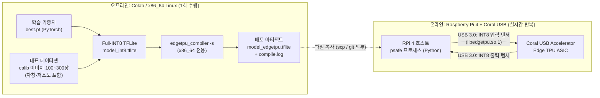
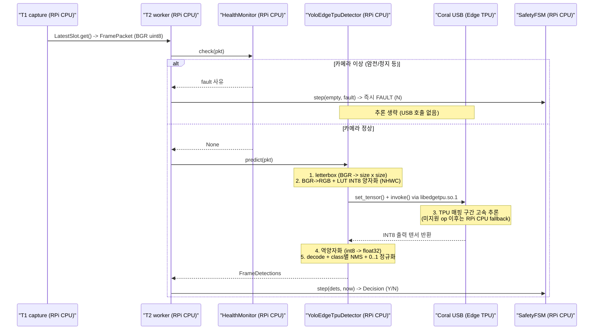
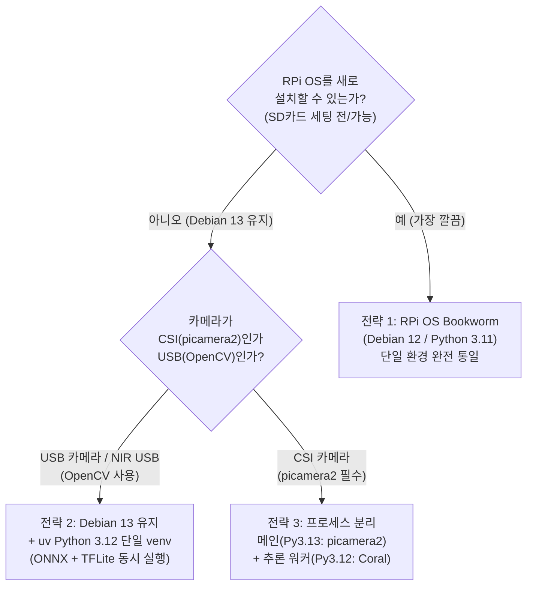
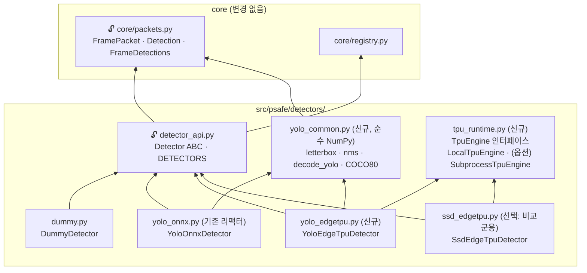
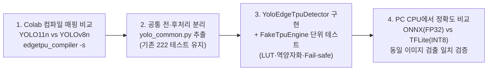

# Coral Edge TPU 소프트웨어 아키텍처 & 파이프라인 설계 (초안)

> 작성일: 2026-11-25 · 상태: HW 수령 전 SW 설계 초안
> 관련 문서: [`docs/DESIGN.md`](DESIGN.md) (§3, §5, §14) · [`docs/CODE_GUIDE.md`](CODE_GUIDE.md) · [`docs/edge_tpu/edge_tpu_research.md`](edge_tpu/edge_tpu_research.md)
> 목적: HW(카메라, Coral USB, RPi 3대) 도착 전에 **Coral을 `psafe` 파이프라인에 어떻게 끼워 넣을지**, **버전이 다른 환경을 어떻게 통일/격리할지**, **HW 없이 PC에서 무엇을 먼저 검증할지**를 확정한다.

---

## 0. 핵심 결론 (한눈에 보기)

1. **Coral은 독립 컴퓨터가 아니라 `Detector` 안의 연산 가속기다.**
   - 프로그램(`psafe`), 카메라 캡처, 전처리, 후처리(NMS), `SafetyFSM`, UDP/시리얼 통신은 모두 **라즈베리파이(호스트)**에서 실행된다.
   - Coral USB는 `Interpreter.invoke()` 내부의 **TPU 매핑 신경망 연산 구간만** USB 3.0으로 넘겨받아 계산한다.
   - 따라서 `Source`, `HealthMonitor`, `SafetyFSM`, `Runner`, `Hub(C)`, `ESP32`는 **단 한 줄도 바꾸지 않는다.** 변경 범위는 `src/psafe/detectors/`와 `config/`로 닫힌다.
2. **환경 차이는 두 층위로 나눠 푼다.**
   - **Colab(변환) ↔ RPi(실행):** Python/OS를 통일할 필요 없다. **모델 아티팩트 계약**(TFLite opcode 버전 + `edgetpu_compiler` 런타임 버전 + 출력 스펙)만 맞춘다.
   - **RPi 내부 Python 버전 충돌(3.13 vs 3.12/3.11):** 1순위는 **단일 환경 통일(In-Process)**, 카메라(`picamera2`) 제약으로 끝내 통일이 안 될 때만 **프로세스 격리(Out-of-Process Worker)**로 우회할 수 있게 `Detector` 내부를 2단으로 설계한다.
3. **Coral 특유의 고장(USB 분리, 로드 실패, 멈춤)은 기존 Fail-safe 체계로 흡수한다.**
   - Delegate 로드 실패 시 CPU fallback 금지(즉시 에러).
   - 실행 중 USB 오류 → `detector_error` FAULT(N).
   - 드라이버 행(hang) → 노드 Heartbeat 만료(600ms) + 허브 타임아웃(500ms) + ESP32 워치독(500ms)의 3중 안전망이 자동으로 N을 보장한다.

---

## 1. 실행 구조: "모델은 어디서 돌아가는가?"

### 1.1 오프라인(변환) vs 온라인(실행) 경계

학습·양자화·컴파일은 **x86_64(Colab/PC)**에서 1회 수행하고, 라즈베리파이는 결과물 파일(`*_edgetpu.tflite`)만 받아 실행한다.



### 1.2 런타임 1프레임 처리 시퀀스 (호스트 CPU vs Coral ASIC)

`ThreadedRunner`의 스레드 구조([`CODE_GUIDE.md`](CODE_GUIDE.md) §4.3)는 그대로 유지되며, `T2 worker`가 호출하는 `Detector.predict()` 내부에서만 Coral과 통신한다.



핵심 포인트:
- **단일 스레드 소유:** TFLite `Interpreter`와 Coral USB 핸들은 스레드 안전하지 않다. `psafe`는 이미 **`T2 worker` 스레드 혼자만 `predict()`를 호출**하는 구조이므로 추가 락이 필요 없다. (`load()`·`warmup()`은 스레드 시작 전 `open_all()`에서 완료됨)
- **비추론 구간 부담 최소화:** Coral이 아무리 빨라도(예: 25~35 ms) RPi CPU의 전처리(`float32` 변환·나눗셈)가 느리면 이득이 줄어든다. 입력 양자화를 256-entry LUT(Look-Up Table)로 처리해 전처리 비용을 1 ms 미만으로 줄인다 (§4.2).

---

## 2. 환경 불일치 해결 전략 (버전 통일 vs 격리)

현재 파악된 제약([`edge_tpu_research.md`](edge_tpu/edge_tpu_research.md) §4.1):
- RPi 4 현 OS: **Debian 13 (trixie)**, 기본 Python **3.13**, `numpy 2.x`, `opencv-python-headless 5.x`
- Coral 런타임: `pycoral`은 3.9에서 종료 → **`tflite-runtime` + `libedgetpu.so.1`** 직접 사용
- `tflite-runtime` 2.17.1: **최대 Python 3.12 wheel(`cp312`)** + **`numpy<2`** 필수 + 같은 TF 버전의 `libedgetpu`와 짝맞춤 필수
- 숨은 변수: **CSI 카메라(`picamera2`)**는 `apt` 시스템 패키지라 OS 기본 Python 버전(Debian 13이면 3.13)의 C 바인딩을 따른다.

### 2.1 하드웨어 조합별 최적 환경 선택 의사결정

HW가 도착하면 아래 의사결정 트리대로 **딱 하나의 기준 환경**을 확정한다.



### 2.2 세 전략 비교

| 항목 | 전략 1: Bookworm (Py 3.11) 통일 | 전략 2: Debian 13 + Py 3.12 단일 venv | 전략 3: Debian 13 + 프로세스 분리 (Sidecar) |
|---|---|---|---|
| **적합 조건** | RPi 3대 새로 세팅 가능 (CSI/USB 무관) | Debian 13 유지 + USB 카메라 | Debian 13 유지 + CSI(`picamera2`) 필수 |
| **환경 개수** | **1개** (시스템 3.11 + venv 1개) | **1개** (`uv` 3.12 venv 1개) | 2개 (`.venv` 3.13 + `.venv-tpu` 3.12) |
| **ONNX ↔ Coral 전환** | `config.yaml` 한 줄 변경 | `config.yaml` 한 줄 변경 | `config.yaml` 한 줄 변경 (`yolo_edgetpu_ipc`) |
| **지연 오버헤드** | 0 ms (In-Process) | 0 ms (In-Process) | +1~3 ms (320×320×3 = 307 KB IPC 복사) |
| **패키지 안정성** | 최상 (공식 wheel + `apt picamera2` + `libedgetpu` Bookworm 릴리스 모두 존재) | 상 (`feranick` 3.12 wheel + `numpy<2` + `opencv<4.11`) | 중 (자식 프로세스 수명·IPC 관리 필요) |
| **다중 보드 C(허브)와 호환** | **완전 호환** (A·B와 C는 UDP JSON v2로만 통신하므로 Python 버전이 달라도 무관) | 완전 호환 | 완전 호환 |

> **설계 권장:**
> - **1순위 (HW 세팅 단계):** 가능하면 카메라 노드 A·B는 **전략 1(Bookworm Python 3.11)** 또는 USB 카메라 확정 시 **전략 2(Python 3.12 단일 venv)**로 통일한다. `pyproject.toml`은 이미 `>=3.11`이므로 `psafe` 코드 수정 없이 ONNX·TFLite·시리얼·테스트 전부가 한 환경에서 돈다.
> - **보험 (SW 구조):** 그래도 전략 3이 필요해질 수 있으므로, 아래 §3처럼 **`EdgeTpuRunner`(실제 추론 엔진)와 `Detector`(파이프라인 어댑터)를 분리**해 둔다. 그러면 전략 3으로 전환할 때 IPC 래퍼 1개만 추가하면 된다.

### 2.3 Colab(변환) ↔ RPi(실행) 아티팩트 호환 규약

두 머신의 Python 버전을 맞추는 대신, **모델 파일과 짝이 되는 매니페스트(메타데이터)**를 고정한다.

| 검증 항목 | 고정 규칙 | 위반 시 증상 |
|---|---|---|
| 입력 shape | 고정 정적 shape `[1, S, S, 3]` (예: 320×320), 동적 축 금지 | `edgetpu_compiler` 실패 |
| 양자화 방식 | Full Integer Quantization (가중치·활성화 INT8), 현장 calibration 100~300장 | `Model not quantized` 또는 recall 급락 |
| TF ↔ `tflite-runtime` | Colab 변환 TF가 내보낸 builtin op 버전을 RPi `tflite-runtime`이 지원해야 함 | `load()` 시 `Didn't find op for builtin opcode` |
| 컴파일러 ↔ `libedgetpu` | `edgetpu_compiler` v16 → RPi `libedgetpu` ≥ v14 (`16.0TF2.17.1` 권장) | `Failed to load delegate` |
| 파일명 규칙 | `*_edgetpu.tflite` + 같은 이름의 `*_edgetpu.log` 보관 | TPU 매핑 비율 추적 불가 |

---

## 3. SW 모듈 아키텍처 (`src/psafe/detectors/` 확장 설계)

기존 [`CODE_GUIDE.md`](CODE_GUIDE.md) §1.2의 계층 규칙(“`detectors`는 `core`만 참조, 구체 클래스는 레지스트리로만 조립”)을 그대로 지킨다.

### 3.1 패키지 구조 & 의존 관계



이렇게 나누면 얻는 구조적 이점:
1. **전·후처리 중복 제거:** [`yolo_onnx.py`](file:///C:/Users/shin/bootcampProject/src/psafe/detectors/yolo_onnx.py)의 `letterbox`, `nms`, `decode`, `COCO80`을 `yolo_common.py`로 뽑아 `YoloOnnxDetector`와 `YoloEdgeTpuDetector`가 공유한다. ONNX와 Edge TPU의 검출 결과가 다를 때 **전·후처리 버그와 INT8 양자화 차이를 명확히 분리**할 수 있다.
2. **비교군 공정 벤치마크:** [`edge_tpu_research.md`](edge_tpu/edge_tpu_research.md) §2-2의 엣지 비교군(**SSDLite MobileDet**, **EfficientDet-Lite**)도 `SsdEdgeTpuDetector`로 같은 `DETECTORS` 레지스트리에 등록하면, `config.yaml`의 `model.name`만 바꿔 **동일한 `bench.py`와 `SafetyFSM` 위에서 end-to-end 지연·recall을 공정 비교**할 수 있다.
3. **전략 3(IPC) 확장성:** `YoloEdgeTpuDetector`가 `tflite_runtime`을 직접 import하지 않고 `TpuEngine` 프로토콜(`load`, `input_spec`, `output_specs`, `invoke(arr) -> list[ndarray]`, `close`)을 통하도록 추상화하면:
   - 평소(전략 1·2): `LocalTpuEngine` (In-Process, 오버헤드 0)
   - 테스트(PC, HW 없음): `FakeTpuEngine` (가짜 INT8 텐서 반환 → `pytest`로 100% 단위 테스트)
   - 환경 분리 필요 시(전략 3): `SubprocessTpuEngine` (`.venv-tpu` 자식 프로세스 호출)

---

## 4. `YoloEdgeTpuDetector` 내부 상세 설계

### 4.1 `TpuEngine` 내부 인터페이스 (단위 테스트·IPC 교체 경계)

```python
@dataclass(frozen=True, slots=True)
class TensorSpec:
    shape: tuple[int, ...]
    dtype: np.dtype
    scale: float        # 양자화 scale (float 텐서면 0.0)
    zero_point: int     # 양자화 zero_point (float 텐서면 0)

class TpuEngine(Protocol):
    def load(self, model_path: str, delegate_path: str) -> None: ...
    def input_spec(self) -> TensorSpec: ...
    def output_specs(self) -> tuple[TensorSpec, ...]: ...
    def invoke(self, inp: np.ndarray) -> tuple[np.ndarray, ...]: ...
    def close(self) -> None: ...
```

### 4.2 데이터 변환 파이프라인 (정확한 shape · dtype · LUT 양자화)

`YoloOnnxDetector`와 `YoloEdgeTpuDetector`의 차이를 표로 고정한다.

| 단계 | `YoloOnnxDetector` (기존) | `YoloEdgeTpuDetector` (신규) |
|---|---|---|
| 1. 리사이즈 | `letterbox(bgr, S)` → `(S, S, 3)` `uint8` | 동일 (`yolo_common.letterbox`) |
| 2. 색/축 변환 | BGR→RGB, **NCHW** `(1, 3, S, S)` `float32 / 255.0` | BGR→RGB, **NHWC** `(1, S, S, 3)` |
| 3. 입력 양자화 | 없음 (FP32) | `load()` 시 256-entry **LUT** 사전 생성 (`dtype`이 `int8`/`uint8`일 때):<br/>`lut[v] = clip(round((v / 255.0) / in_scale) + in_zp, qmin, qmax)`<br/>추론 시 `q = lut[rgb][None]` 한 줄로 변환 (float 연산 0회) |
| 4. 추론 실행 | `ort.InferenceSession.run(...)` | `engine.invoke(q)` → `libedgetpu.so.1` delegate 실행 |
| 5. 출력 역양자화 | 없음 (FP32) | `dtype`이 정수면 `y = (raw.astype(np.float32) - out_zp) * out_scale` |
| 6. 출력 축/좌표 | `(1, 4+nc, N)`, 픽셀 단위 `(0..S)` | Ultralytics TFLite export는 보통 `(1, 4+nc, N)`이면서 **좌표가 `0..1` 정규화**되어 나오는 경우가 많음.<br/>→ `coords_normalized: bool = True` (또는 설정 명시)로 `S`를 곱해 픽셀 단위로 맞춘 뒤 공통 `decode_yolo`에 전달 |
| 7. 후처리 | `decode` → `nms` → `class_map` → `classes` 필터 | **완전히 동일** (`yolo_common.decode_yolo`) |

> **주의 (실제 첫 변환 시 반드시 확인할 2가지):**
> 1. TFLite 모델의 출력 좌표가 `0..1` 정규화인지 `0..S` 픽셀 단위인지 (`test_edgetpu_matches_onnx` 동등성 테스트로 즉시 검증).
> 2. TFLite 파일에는 ONNX의 `custom_metadata_map["names"]`가 없을 수 있으므로, **클래스 이름 목록(`names`)을 `config.yaml` 또는 모델 옆 `*.names.yaml`에서 명시적으로 지정**할 수 있게 설계한다(미지정 시 `COCO80` 기본값, 출력 채널 수 `4 + len(names)` 불일치 시 `load()`에서 즉시 에러).

### 4.3 `config.yaml` 예시 (기존 설정 구조와 100% 호환)

`core/config.py`를 수정할 필요 없이 `model.name`과 `model.options`만 바꾼다.

```yaml
# 예: config/rpi_edgetpu.yaml (추후 RPi 실기용)
model:
  name: yolo_edgetpu
  options:
    weights: models/yolov8n_320_full_integer_quant_edgetpu.tflite
    delegate: libedgetpu.so.1          # Windows 테스트/문서화: edgetpu.dll
    conf_threshold: 0.20
    iou_threshold: 0.45
    coords_normalized: true            # Ultralytics TFLite export 기준 (변환 후 실측 확정)
    names: null                        # null이면 COCO80, 파인튜닝 모델이면 ["person"] 등 명시
    class_map: {}                      # 예: { minifig: person }
    classes: ["person", "car"]
    # 전략 3(IPC) 전환 시에만 추가:
    # worker_python: /home/linux/bootcampProject/.venv-tpu/bin/python
```

---

## 5. Fail-Safe 및 고장 처리 설계 (Coral 특화)

Coral USB는 CPU 추론과 달리 **물리 USB 연결·전원·외부 드라이버**라는 새로운 고장 지점을 가진다. `psafe`의 안전 원칙(DESIGN §2)에 따라 모든 고장 경로의 동작을 미리 확정한다.

| 고장 시나리오 | 발생 위치 | SW 대응 정책 | 최종 출력 |
|---|---|---|---|
| **1. Coral 미연결 / `libedgetpu.so.1` 로드 실패** | `load()` | **CPU fallback 절대 금지.** 즉시 `RuntimeError` 발생 후 시작 중단 (종료 코드 2). CPU INT8로 조용히 떨어지면 수백 ms 지연으로 E-08 FAULT만 반복되므로 시작 시 바로 드러낸다. | 시작 불가 (ESP32는 워치독/부팅 N 유지) |
| **2. 모델 파일이 TPU 미컴파일(일반 TFLite)** | `load()` | `weights` 경로 경고 또는 `warmup()` 지연/매핑 검사로 알림. (`_edgetpu.tflite` 권장) | 설정 오류 조기 발견 |
| **3. 실행 중 USB 뽑힘 / 전원 부족(brownout)** | `predict()` → `invoke()` | 예외를 숨기지 않고 상위로 던짐 → [`process_frame()`](file:///C:/Users/shin/bootcampProject/src/psafe/runners.py#L37-L41)이 잡아 `fsm.fault("detector_error")` 반환. | **즉시 `N` (`FAULT`)** |
| **4. USB 오류 연속 발생 (복구 불가 핸들)** | `YoloEdgeTpuDetector` | `max_consecutive_errors`(예: 5회) 초과 시 치명적 오류로 스레드 종료 → `ThreadedRunner`가 `shutdown` N 송신 후 종료 → `systemd`가 프로세스 재시작. (USB 재연결 시 새 프로세스가 깨끗하게 장치 재오픈) | 종료 시 `N` + 재시작 중 ESP32/Hub 500ms 타임아웃 `N` |
| **5. `invoke()` 내부 USB 드라이버 영구 멈춤(Hang)** | `T2 worker` | worker가 멈춰도 `T3 heartbeat`는 살아 있음 → [`expire_decision()`](file:///C:/Users/shin/bootcampProject/src/psafe/runners.py#L45-L56)이 600ms 초과 시 `decision_stale` N + `confirm="fault"` 송신. 만약 프로세스 전체가 멈추면 Hub C(500ms)와 ESP32(500ms)가 각각 `N` 전환. | **최대 0.5~0.8초 내 `N`** |
| **6. 프로세스 분리(전략 3) 워커 사망/응답 지연** | `SubprocessTpuEngine` | `invoke()`에 명시적 타임아웃(예: `300 ms`) 적용 → 초과 시 워커 `kill()` + 예외 발생 → `detector_error` N. (오래된 프레임으로 뒤늦게 응답하는 것을 원천 차단) | **즉시 `N` (`FAULT`)** |
| **7. INT8 양자화로 인한 특정 장면 Recall 저하** | 모델 품질 | 런타임에서 감지 불가(안전 위험). 오프라인 검증 게이트(§6.2)에서 FP32 ONNX 대비 차 안/저조도 장면 recall을 비교 통과한 모델만 배포. | 배포 게이트로 차단 |

---

## 6. HW 도착 전 · 후 단계별 실행 계획

HW를 기다리며 놀지 않고, **지금 당장 PC/Colab에서 할 수 있는 검증**과 **HW 도착 직후 할 검증**을 나눈다.

### 6.1 지금 바로 할 수 있는 것 (HW 불필요)



1. **Colab 컴파일 매핑 실험 (최우선, HW 0개 필요):**
   - `edgetpu_compiler`는 x86_64 도구이므로 Coral 없이도 Colab에서 `yolo11n_320`과 `yolov8n_320`을 컴파일하고 `-s` 로그를 확인할 수 있다.
   - 여기서 **YOLO11n의 `C2PSA`(BatchMatMul)가 실제로 그래프를 끊는지**가 HW 도착 전에 확정된다. 끊긴다면 파인튜닝 베이스 모델을 일찍 **YOLOv8n**으로 확정할 수 있어 시행착오를 크게 줄인다.
2. **SW 인터페이스·구현 선행 (Mock 기반):**
   - `yolo_common.py` 분리 + `tpu_runtime.py` + `yolo_edgetpu.py` 작성.
   - `FakeTpuEngine`으로 LUT 양자화 오차, 역양자화, `coords_normalized`, delegate 실패 시 fail-fast, `invoke()` 예외 시 `detector_error` N 전환, `bench.py`의 다중 검출기(`--model yolo_edgetpu`) 지원을 모두 PC `pytest`로 완성해 둔다.
3. **FP32(ONNX) ↔ INT8(TFLite) 오차 검증:**
   - 일반 TFLite(INT8, 미컴파일본)는 PC CPU에서도 돌아가므로, 같은 테스트 영상/이미지에서 `YoloOnnxDetector`와 `YoloEdgeTpuDetector`(CPU TFLite)의 박스·신뢰도·person recall 차이를 미리 측정한다.

### 6.2 HW 도착 직후 실행 순서 (RPi 4 + Coral USB + 카메라)

1. **카메라 방식 확인 (USB vs CSI)** → §2.1 의사결정 트리로 **전략 1 / 2 / 3 확정**.
2. **RPi 환경 세팅 및 `LocalTpuEngine` delegate 로드 확인** (에러 없이 `allocate_tensors()` 통과).
3. **`psafe.tools.bench` 실측 (EXP-012 예정):**
   - 동일 RPi 4에서 `yolo11n_320 (ONNX CPU, 104 ms)` vs `yolov8n_320 (Coral)` vs `yolo11n_320 (Coral)` vs `SSDLite MobileDet (Coral)`의 **end-to-end 지연(전처리+추론+NMS)**과 **30분 연속 실행 온도(E-09)** 비교.
4. **고장 시연 검증:** 실행 중 Coral USB 뽑기 → 0.5초 내 `FAULT(N)` 및 C `UNKNOWN` / ESP32 `N` 확인.

---

## 7. 결정이 필요한 열린 질문 (팀/본인 확인용)

- [ ] **RPi OS 선택:** 본 프로젝트용 RPi 3대에 **Bookworm(Debian 12, Python 3.11)**을 새로 올릴 수 있는가, 아니면 기존 Debian 13을 유지해야 하는가? (Bookworm 가능 시 환경 충돌 문제가 가장 깔끔하게 사라짐)
- [ ] **카메라 인터페이스:** 도착 예정인 NIR 카메라 2대가 **USB(UVC)**인가 **CSI(`picamera2`)**인가?
- [ ] **모델 확정:** Colab `edgetpu_compiler -s` 결과에서 YOLO11n이 C2PSA에서 CPU로 떨어진다면 **YOLOv8n**으로 베이스 모델을 전환할 것인가?
- [ ] **USB 분리 복구 정책:** 실행 중 Coral USB가 순간 끊겼을 때 `detector_error` N을 유지하며 프로세스 내부 재연결을 시도할지, 아니면 `max_consecutive_errors` 후 프로세스 종료 + `systemd` 재시작으로 단순화할지?
