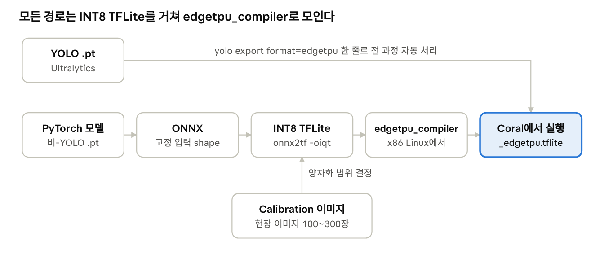

# 객체탐지 비교군 모델 & Edge TPU INT8 변환 조사

2026-11-23 기준 (같은 날 검토 반영: Coral 공식 문서·모델표 확인, RPi 실행 제약 조사 추가). 2026-11-24: §2-2 수치를 원문에서 재확인하고 추정치를 제거함

## 개요

비-YOLO 비교군은 **Faster R-CNN(2-stage 정확도 기준선)**, **SSD MobileNet / SSDLite MobileDet / EfficientDet-Lite(Edge TPU 실행 가능 1-stage)**, **RT-DETR(Transformer 실시간 탐지기)** 3계열로 잡는 것을 추천합니다. Edge TPU에는 전체 INT8 양자화된 TFLite를 `edgetpu_compiler`로 다시 컴파일해야 하며, YOLO는 Ultralytics `format=edgetpu` 한 줄로, 일반 PyTorch/ONNX 모델은 `onnx2tf` → INT8 TFLite → `edgetpu_compiler` 순서로 변환합니다.

- `2-2` 비교군: Faster R-CNN과 RT-DETR은 Edge TPU로 컴파일되지 않으므로 GPU/CPU에서 정확도·속도 기준선으로 쓰고, Edge TPU 위 비교는 SSD MobileNet / SSDLite MobileDet / EfficientDet-Lite로 합니다.
- `3-2` 변환: 대표 데이터셋(calibration 이미지 100~300장)과 고정 입력 크기가 핵심이며, 지원되지 않는 연산은 CPU로 떨어져 속도가 크게 느려집니다.
- **우리 장비(RPi 4 + Coral USB, Debian 13 / Python 3.13)에서 돌리는 조건은 [§4 실행 제약](#4-우리-장비에서-돌리기-위한-제약-rpi-4--coral-usb)에 따로 정리했습니다.** 가장 큰 걸림돌은 Python 3.13용 Edge TPU 파이썬 런타임이 없다는 점입니다.

## 2-2 비교군 후보와 선정 기준

비교군은 "탐지 방식이 YOLO와 다른 계열"이면서 "공개 가중치·동일 데이터셋(COCO) 수치가 있는" 모델로 고릅니다. 여기에 Edge TPU 배포 가능 여부를 추가 기준으로 둡니다.

| 후보 | 계열 | 역할 | Edge TPU 배포 | 선정 |
| --- | --- | --- | --- | --- |
| Faster R-CNN (ResNet-50 FPN) | 2-stage, anchor 기반 | 고정확도 고전 기준선 | 불가 (RoIAlign·동적 shape) | ✅ 필수 |
| SSD / SSDLite (MobileNet) | 1-stage, anchor 기반 | 경량 엣지 기준선 | 가능 (Coral 공식 모델 존재) | ✅ 필수 |
| SSDLite MobileDet | 1-stage, Edge TPU용 NAS backbone | 엣지 기준선 중 정확도 최상 | 가능 (Coral 공식 모델, 9.1 ms / 32.9%) | ✅ 추천 |
| EfficientDet-Lite (0~3) | 1-stage, BiFPN | 엣지용 정확도/속도 균형 | 가능 (Coral 공식 모델 존재) | ✅ 추천 |
| RT-DETR (R18/R50) | Transformer, NMS-free | 최신 실시간 비-YOLO | 불가 (attention: BatchMatMul 미지원) | ✅ 추천 |
| RetinaNet (ResNet-50 FPN) | 1-stage, Focal Loss | anchor 1-stage 비교 | 어려움 (모델 크기·후처리) | 선택 |
| DETR / Deformable DETR | Transformer | 연구용 | 불가 | 제외 (느리고 학습 길음) |

최소 구성은 **Faster R-CNN + SSD MobileNet**, 여유가 있으면 **SSDLite MobileDet / EfficientDet-Lite와 RT-DETR**까지 넣어 "정확도 기준선 / 엣지 기준선 / 최신 모델"을 모두 덮는 것을 권장합니다.

> **비교의 공정성 주의.** Coral의 SSD·EfficientDet은 COCO(90클래스)로 학습된 TF 모델이고, Coral 스스로 "production-quality가 아닌 데모용"이라고 밝힙니다. 재학습 도구(TFLite Model Maker, TF Object Detection API)는 사실상 유지보수가 끊겨 최신 Python에서 잘 돌지 않습니다. 우리가 차 안 탑승자로 fine-tune한 YOLO와 사전학습 그대로의 SSD를 비교하면 공정하지 않으므로, 비교를 두 단계로 나눕니다.
> 1. **사전학습 vs 사전학습**: COCO 가중치 그대로, person 클래스만 같은 테스트셋에서 비교
> 2. **fine-tune 효과**: YOLO만 우리 데이터로 fine-tune 전후 비교

## 2-2 모델 구조와 Netron 확인

Netron에서는 각 모델을 ONNX(또는 TFLite)로 내보낸 뒤 열면 **Backbone → Neck → Head → 후처리** 구간이 그대로 보입니다. 보고서에는 아래 표의 "Netron에서 볼 곳"을 캡처해 넣으면 됩니다.

| 모델 | Backbone | Neck | Head / 후처리 | Netron에서 볼 곳 |
| --- | --- | --- | --- | --- |
| Faster R-CNN | ResNet-50 | FPN (P2~P6) | RPN → RoIAlign → 2-FC box/cls head, NMS 2회 | RPN 출력과 RoIAlign 노드, 후반부 동적 shape 연산 |
| SSD / SSDLite | VGG16 / MobileNetV2·V3 | 다중 스케일 feature map (추가 conv) | scale별 conv head + anchor decode + NMS | depthwise conv 블록, `TFLite_Detection_PostProcess` 노드 |
| EfficientDet-Lite | EfficientNet-Lite | BiFPN | class/box conv head + NMS | BiFPN 반복 구조(가중 합) |
| RetinaNet | ResNet-50 | FPN (P3~P7) | 4-conv cls/box subnet, Focal Loss | head가 레벨별로 공유되는 구조 |
| RT-DETR | ResNet-18/50 (vd) | Hybrid Encoder (AIFI + CCFM) | Transformer decoder, query 300개, NMS 없음 | MatMul/Softmax attention 블록, NMS 노드 부재 |
| YOLO11 (참고) | C3k2 + **C2PSA**(attention) | PAN | anchor-free decoupled head + NMS | backbone 끝 C2PSA의 MatMul/Softmax — Edge TPU 매핑 위험 지점 (§4.3) |

### Netron 사용법

1. 설치: `pip install netron` (또는 웹 버전 [netron.app](https://netron.app)에 파일 드래그)
2. 실행: `netron model.onnx` → 브라우저에서 그래프 열림
3. torchvision 모델을 ONNX로 내보내는 예:

```python
import torch, torchvision
m = torchvision.models.detection.fasterrcnn_resnet50_fpn_v2(weights="DEFAULT").eval()
torch.onnx.export(m, torch.randn(1, 3, 640, 640), "frcnn.onnx", opset_version=17,
                  input_names=["images"], output_names=["boxes", "labels", "scores"],
                  dynamo=False)   # 최신 PyTorch는 dynamo=True가 기본이라 detection 모델에서 실패할 수 있음
```

RT-DETR은 Ultralytics에서 바로 내보낼 수 있습니다: `yolo export model=rtdetr-l.pt format=onnx`.

## 2-2 정확도·추론 속도 비교와 추천

2026-11-24에 아래 수치를 모두 원문에서 다시 확인했습니다. **추정치는 넣지 않았습니다.** 원문에 없는 값은 "찾지 못함"으로 적었습니다. 정확도는 모두 COCO **80개 클래스 전체** box mAP입니다(person 한 클래스 값이 아닙니다). 속도는 출처마다 하드웨어·측정 범위가 달라서 **같은 표의 같은 열끼리만** 비교할 수 있습니다.

### 표 1. 정확도 기준선 후보 (GPU/CPU 실행용, Edge TPU 불가 포함)

| 모델 | COCO val2017 box mAP (검증 이미지 5,000장 기준 정확도, 높을수록 좋음) | Params (M) (가중치 개수, 백만 단위 · 모델 크기) | GFLOPs (이미지 1장 처리 계산량, 10억 회 단위 · 낮을수록 가벼움) | 공개된 속도 (출처의 측정 조건 그대로) |
| --- | --- | --- | --- | --- |
| RT-DETR-R50 | 53.1 | 42 | 136 | 108 FPS — T4 GPU, TensorRT FP16, batch 1, 입력 640 [1] |
| RT-DETR-R18 | 46.5 | 20 | 60 | 217 FPS — 같은 조건 [2] |
| fasterrcnn_resnet50_fpn_v2 | 46.7 | 43.7 | 280.37 | **찾지 못함** (torchvision 문서에 속도 열 없음) [3] |
| retinanet_resnet50_fpn_v2 | 41.5 | 38.2 | 152.24 | **찾지 못함** [3] |
| fcos_resnet50_fpn | 39.2 | 32.3 | 128.21 | **찾지 못함** [3] |
| fasterrcnn_resnet50_fpn (v1) | 37.0 | 41.8 | 134.38 | **찾지 못함** (절대값 없음. "MobileNetV3 FPN이 CPU에서 5배, 320 FPN이 25배 빠르다"는 상대값만 있음 [5]) |
| fasterrcnn_mobilenet_v3_large_fpn | 32.8 | 19.4 | 4.49 | CPU 0.8409 초/장 [4] |
| fasterrcnn_mobilenet_v3_large_320_fpn | 22.8 | 19.4 | 0.72 | CPU 0.1679 초/장 [4] |
| ssd300_vgg16 | 25.1 | 35.6 | 34.86 | CPU 0.8303 초/장 [4] |
| ssdlite320_mobilenet_v3_large | 21.3 | 3.4 | 0.58 | CPU 0.0911 초/장 [4] |

- [1] [RT-DETR 논문](https://arxiv.org/abs/2304.08069) v3 Table 2. FPS에 후처리 포함 여부는 논문에 명시되지 않음 (RT-DETR은 NMS가 없는 구조).
- [2] [RT-DETR 공식 GitHub README](https://github.com/lyuwenyu/RT-DETR)의 모델 표. R18은 논문 본문 표에는 없고 README에만 있음. README에는 batch 크기가 적혀 있지 않음.
- [3] [torchvision 공식 문서](https://docs.pytorch.org/vision/stable/models.html)의 Object Detection 가중치 표. mAP·Params·GFLOPs만 있고 **지연 열은 없음**. 평가 입력 크기도 적혀 있지 않음.
- [4] [PyTorch 블로그: TorchVision's SSDlite implementation](https://pytorch.org/blog/torchvision-ssdlite-implementation/)의 표 (열 이름 "Inference on CPU (sec)"). **CPU 기종, 스레드 수, 입력 크기, batch는 적혀 있지 않음** → 모델끼리의 상대 비교로만 쓸 수 있고, 우리 Pi 시간으로 옮길 수 없음.
- [5] [PyTorch 블로그: torchvision v0.9 모델](https://pytorch.org/blog/ml-models-torchvision-v0-9/). 측정 조건은 적혀 있지 않음.

### 표 2. Coral 공식 Edge TPU 모델 (INT8)

출처: [Coral 객체 탐지 모델 페이지](https://coral.ai/models/object-detection/). 지연은 원문 각주 그대로 "Coral USB Accelerator + 데스크톱 CPU에서 추론 1회 시간"이며, 원문도 "시스템마다 다르고 모델 간 비교용"이라고 밝힙니다. **호스트 CPU 기종과 런타임은 적혀 있지 않습니다.** mAP는 "COCO17의 부분집합"으로 평가했다고만 되어 있고, 어떤 부분집합인지는 적혀 있지 않습니다. 페이지 맨 위에 "production-quality가 아닌 데모용"이라는 공지가 있습니다.

| 모델 | 입력 | Edge TPU 지연 (ms) | mAP (COCO17 부분집합) | 모델 크기 |
| --- | --- | --- | --- | --- |
| SSD MobileNet V1 | 300×300 | 6.5 | 21.5 | 7.0 MB |
| SSD MobileNet V2 | 300×300 | 7.3 | 25.6 | 6.6 MB |
| SSD MobileNet V2 (TF2) | 300×300 | 7.6 | 22.4 | 6.7 MB |
| **SSDLite MobileDet** | 320×320 | **9.1** | **32.9** | 5.1 MB |
| SSD/FPN MobileNet V1 (TF2) | 640×640 | 229.4 | 31.1 | 37.7 MB |
| EfficientDet-Lite0 | 320×320 | 37.4 | 30.4 | 5.7 MB |
| EfficientDet-Lite1 | 384×384 | 56.3 | 34.3 | 7.6 MB |
| EfficientDet-Lite2 | 448×448 | 104.6 | 36.0 | 10.2 MB |
| EfficientDet-Lite3 | 512×512 | 107.6 | 39.4 | 14.4 MB |
| EfficientDet-Lite3x | 640×640 | 197.0 | 43.9 | 20.6 MB (**USB 불가**, PCIe 전용. 이 행만 PCIe 카드로 측정) |

참고: Coral [성능 벤치마크 페이지](https://coral.ai/docs/edgetpu/benchmarks/)에는 같은 계열 모델의 CPU 단독 대비 수치가 있습니다. MobileNet v1 SSD(224×224)는 데스크톱 CPU(Xeon Gold 6154) 109 ms → USB Accelerator(USB 3.0) 6.5 ms, Cortex-A53 1.5 GHz 단독 353 ms → Dev Board(Edge TPU) 11 ms입니다. 원문 기준으로 **모델 실행 시간만** 잰 값이고 입력 전처리는 빠져 있습니다(후처리 포함 여부는 적혀 있지 않음). **Raspberry Pi 측정은 이 페이지에 없습니다.**

### 표 3. YOLO + Coral on Raspberry Pi (Ultralytics 가이드)

출처: [Ultralytics Raspberry Pi + Coral 가이드](https://docs.ultralytics.com/guides/coral-edge-tpu-on-raspberry-pi/). 원문 조건: Raspberry Pi OS Bookworm 64-bit, USB Coral, **추론 시간만(전처리·후처리 제외)**, YOLOv8으로 측정.

| 입력 | 모델 | Standard (ms) | High-Frequency (ms) |
| --- | --- | --- | --- |
| 320 | YOLOv8n | 32.2 | 26.7 |
| 320 | YOLOv8s | 47.1 | 39.8 |
| 512 | YOLOv8n | 73.5 | 60.7 |
| 512 | YOLOv8s | 149.6 | 125.3 |

- 그래프에는 "Raspberry Pi 4B 2GB"와 "Raspberry Pi 5 8GB"가 함께 나오지만, **표의 숫자가 어느 Pi에서 나왔는지는 적혀 있지 않습니다.** 원문의 평균 비교는 Pi 5가 Pi 4B보다 Standard 22%, High-Frequency 30.2% 빠르다는 것입니다.
- **YOLO11 + Coral 수치는 공식 문서에서 찾지 못했습니다.** (가이드 댓글에 유지보수자의 대략적 범위 언급이 있다는 요약을 봤지만 원문을 확인하지 못해 싣지 않았습니다.)

### 찾지 못한 것 (우리가 직접 재야 함)

| 항목 | 상태 |
| --- | --- |
| 위 모델들의 **person 클래스만의** AP·recall | 공식 표는 모두 80개 클래스 전체 mAP만 제공 |
| torchvision ResNet-50 계열(Faster R-CNN, RetinaNet, FCOS)의 절대 지연 | 공식 자료에 없음 |
| **Raspberry Pi 4 CPU** 지연 | 공개 자료 없음. 우리 측정값은 yolo11n 320, 4스레드, end-to-end p50 104.4 ms (EXPERIMENTS EXP-005) |
| Raspberry Pi 4 + Coral에서 SSD/MobileDet/EfficientDet 지연 | 공개 자료 없음 (Coral 표는 데스크톱 CPU 호스트) |
| YOLO11n의 Edge TPU 매핑 결과·지연 | 공개 자료 없음 → §4.3 컴파일 로그로 확인 |
| 전처리·NMS를 포함한 end-to-end 지연 | 위 모든 출처가 모델 실행 시간만 보고함 |

> **우리 프로젝트의 평가 지표는 COCO 전체 mAP가 아닙니다.** 목표는 차 안 탑승자를 포함한 **person 한 클래스**를 놓치지 않는 것이므로, 같은 테스트셋에서 ① person recall(장면별: 일반 / 차창 너머 / 저조도 / 썬팅) ② 장면별 미탐 사례 ③ RPi 4 + Coral USB에서 **전처리 + 추론 + NMS 전체(end-to-end)** 지연을 잽니다. 위 표의 mAP와 ms는 후보를 좁히는 참고용입니다.

**최종 추천**

- 정확도 기준선: `fasterrcnn_resnet50_fpn_v2` (torchvision, 바로 fine-tuning 가능)
- 엣지 기준선: **SSDLite MobileDet** (Coral 표에서 9.1 ms·32.9 mAP로, 10 ms 안쪽 모델 중 mAP가 가장 높음. 데스크톱 호스트 기준이라 Pi에서는 직접 측정 필요). 비교용으로 SSD MobileNet V2를 함께 둬도 됨
- 최신 비교: RT-DETR-R18 (Ultralytics로 학습·내보내기 간편)

## 3-2 Edge TPU 요구사항과 변환 파이프라인

Edge TPU는 **8-bit 정수 연산만** 가속하므로, 어떤 모델이든 ① 고정 shape ② 대표 데이터셋 기반 full integer 양자화 ③ `edgetpu_compiler` 컴파일을 거쳐야 합니다.



YOLO는 Ultralytics가 아래 줄의 단계를 자동으로 처리하고, 비-YOLO 모델은 각 단계를 직접 실행합니다. SavedModel이 있다면 onnx2tf 대신 TF Converter로 INT8 TFLite를 만들 수도 있습니다.

## 3-2 YOLO(Ultralytics) → Edge TPU

Ultralytics는 `format="edgetpu"` 하나로 PyTorch → ONNX → TF SavedModel → INT8 TFLite → `edgetpu_compiler`를 자동 수행합니다. **x86_64 Linux(또는 Colab, Docker)에서 실행**해야 하며, ARM(라즈베리파이)에서는 컴파일러가 돌지 않습니다.

```python
from ultralytics import YOLO

model = YOLO("best.pt")          # 학습한 가중치
model.export(
    format="edgetpu",
    imgsz=320,                     # Edge TPU는 320~416 권장 (클수록 CPU 분할 위험)
    data="data.yaml",              # INT8 calibration용 데이터셋 — 반드시 우리 데이터로 지정
)
# → best_saved_model/best_full_integer_quant_edgetpu.tflite
```

```bash
# CLI
yolo export model=best.pt format=edgetpu imgsz=320 data=data.yaml

# 검증 (Coral 장착 장비, 또는 x86에서 CPU로)
yolo val model=best_saved_model/best_full_integer_quant_edgetpu.tflite data=data.yaml imgsz=320
```

| 인자 | 기본값 | 의미 |
| --- | --- | --- |
| `format` | `edgetpu` | Edge TPU용 TFLite |
| `imgsz` | 640 | 입력 크기, 정수 또는 (h, w) |
| `quantize` | 8 (자동) | INT8 필수·자동 적용. 구버전의 `half`/`int8` 플래그를 대체 |
| `opset` | None | ONNX opset |
| `data` | None | calibration 데이터. **생략하면 태스크 기본 데이터셋(COCO 샘플)이 쓰여 우리 장면과 맞지 않음** |
| `fraction` | 1.0 | calibration에 쓸 비율·장수, 또는 `[train, val, test]` 비율 |
| `device` | None | 예: `cpu` |

- 출력 파일명은 `_edgetpu.tflite`로 끝나야 Ultralytics가 Edge TPU 모델로 인식합니다(이름을 바꾸면 일반 TFLite로 로드).
- 구버전 ultralytics는 `quantize` 대신 `int8=True`를 씁니다. 설치된 버전에 맞춰 쓰세요.
- **calibration 데이터 구성(우리 프로젝트):** 일반 사람 장면뿐 아니라 **차창 너머 탑승자(반사·썬팅·저조도)** 이미지가 반드시 섞여야 합니다. 빠지면 INT8 활성화 범위가 그 장면에 맞지 않아, 가장 중요한 장면에서 recall이 떨어집니다. INT8 변환 전후 recall을 같은 테스트셋으로 비교하세요.

출처: [Ultralytics Edge TPU 문서](https://docs.ultralytics.com/integrations/edge-tpu/), [Raspberry Pi + Coral 가이드](https://docs.ultralytics.com/guides/coral-edge-tpu-on-raspberry-pi).

## 3-2 PyTorch / ONNX → INT8 TFLite

YOLO가 아닌 모델은 **PyTorch → ONNX → (onnx2tf) → INT8 TFLite** 경로가 가장 흔합니다. 핵심은 고정 입력 shape과 calibration 데이터입니다.

### 1단계: PyTorch → ONNX (고정 shape)

```python
import torch
model = ...  # 학습된 nn.Module, eval() 상태
dummy = torch.randn(1, 3, 320, 320)
torch.onnx.export(model.eval(), dummy, "model.onnx", opset_version=17,
                  input_names=["images"], output_names=["output"],
                  dynamic_axes=None,   # Edge TPU는 동적 축 불가
                  dynamo=False)
```

```bash
pip install onnxsim && onnxsim model.onnx model_sim.onnx   # 그래프 단순화 권장
```

### 2단계: calibration 데이터 준비

onnx2tf는 0~1로 정규화된 NHWC numpy 배열을 받습니다. 실제 현장 이미지 100~300장을 쓰는 것이 좋습니다(위의 차 안 탑승자 구성 원칙 동일).

```python
import numpy as np, glob, cv2
imgs = []
for p in sorted(glob.glob("calib/*.jpg"))[:200]:
    im = cv2.cvtColor(cv2.imread(p), cv2.COLOR_BGR2RGB)
    imgs.append(cv2.resize(im, (320, 320)).astype(np.float32) / 255.0)
np.save("calib.npy", np.stack(imgs))   # (N, 320, 320, 3)
```

### 3단계: onnx2tf로 INT8 TFLite 생성

```bash
pip install -U onnx2tf  # TF 백엔드가 필요하면 'onnx2tf[tensorflow]'

onnx2tf -i model_sim.onnx -o saved_model \
  -oiqt -qt per-channel \
  -cind images calib.npy "[[[[0.,0.,0.]]]]" "[[[[1.,1.,1.]]]]"
# -oiqt : 정수 양자화 TFLite 출력
# -cind : calibration 입력 (입력명, npy, mean, std)
# -qt   : per-channel(기본) / per-tensor
```

`saved_model/` 안에 float32·INT8 등 여러 .tflite가 생깁니다. Edge TPU에는 입·출력까지 정수인 **full integer quant** 파일을 사용하세요(정확한 파일명은 버전마다 다르니 출력 폴더에서 확인). 최신 onnx2tf README는 PyTorch 모델이라면 **LiteRT Torch**(구 ai-edge-torch)로 직접 변환하는 것도 권장합니다.

torchvision SSD처럼 **NMS가 그래프 안에 있는 모델**은 NMS가 Edge TPU에서 돌지 않으므로, head 출력까지만 내보내고 NMS는 CPU 후처리로 분리하세요.

### 대안: TensorFlow Converter로 직접 INT8 변환

SavedModel이 있다면 TF 공식 API로 full-integer 양자화를 할 수 있습니다.

```python
import tensorflow as tf, numpy as np
calib = np.load("calib.npy")

def representative_dataset():
    for i in range(len(calib)):
        yield [calib[i:i+1]]

conv = tf.lite.TFLiteConverter.from_saved_model("saved_model")
conv.optimizations = [tf.lite.Optimize.DEFAULT]
conv.representative_dataset = representative_dataset
conv.target_spec.supported_ops = [tf.lite.OpsSet.TFLITE_BUILTINS_INT8]
conv.inference_input_type = tf.uint8    # 또는 tf.int8
conv.inference_output_type = tf.uint8
open("model_int8.tflite", "wb").write(conv.convert())
```

출처: [onnx2tf](https://github.com/PINTO0309/onnx2tf), [TensorFlow 후훈련 정수 양자화](https://www.tensorflow.org/lite/performance/post_training_integer_quant).

## 3-2 edgetpu_compiler, 검증, 트러블슈팅

INT8 TFLite를 `edgetpu_compiler`로 컴파일해야 Edge TPU에서 가속됩니다. 컴파일러는 **x86-64 64-bit Debian 계열**에서만 동작합니다(ARM64판은 2.1부터 배포 중단). 출처: [Coral 컴파일러 문서](https://coral.ai/docs/edgetpu/compiler/).

```bash
# 설치 (x86_64 Linux / Colab) — 공식 문서 명령
curl https://packages.cloud.google.com/apt/doc/apt-key.gpg | sudo apt-key add -
echo "deb https://packages.cloud.google.com/apt coral-edgetpu-stable main" | \
  sudo tee /etc/apt/sources.list.d/coral-edgetpu.list
sudo apt-get update && sudo apt-get install -y edgetpu-compiler

# apt-key가 없는 최신 Debian/Ubuntu에서는 키링 방식으로:
#   curl -fsSL https://packages.cloud.google.com/apt/doc/apt-key.gpg | \
#     sudo gpg --dearmor -o /usr/share/keyrings/coral-edgetpu.gpg
#   echo "deb [signed-by=/usr/share/keyrings/coral-edgetpu.gpg] https://packages.cloud.google.com/apt coral-edgetpu-stable main" | \
#     sudo tee /etc/apt/sources.list.d/coral-edgetpu.list

# 컴파일
edgetpu_compiler -s -o out/ model_int8.tflite
# → out/model_int8_edgetpu.tflite, out/model_int8_edgetpu.log
```

| 옵션 | 의미 |
| --- | --- |
| `-o, --out_dir DIR` | 출력 폴더 (기본: 현재 폴더) |
| `-s, --show_operations` | 연산별 Edge TPU/CPU 매핑 표 출력 (같은 내용이 항상 `.log`에도 저장) |
| `-i, --intermediate_tensors 이름,...` | 지정한 텐서를 Edge TPU 구간의 출력으로 삼고, 그 뒤는 CPU에서 실행 (TPU 구간 끝을 직접 지정) |
| `-n, --num_segments N` | 파이프라이닝용 N개 세그먼트로 분할 (TPU 여러 개) |
| `-m, --min_runtime_version VER` | 대상 Edge TPU 런타임 최소 버전 |
| `-d, --search_delegate` | (v16+) 컴파일이 실패하면 **더 앞쪽 지점**을 반복 탐색해 그 앞까지만 TPU로 컴파일 → TPU에 남는 연산은 줄어듦 |
| `-k, --delegate_search_step N` | (v16+) `-d` 탐색 간격(연산 수, 기본 1) |
| `-t, --timeout_sec N` | 컴파일 제한 시간 (기본 180초) |
| `-v, --version` | 컴파일러 버전 출력 |

컴파일러 16.0으로 만든 모델은 기본적으로 Edge TPU 런타임 14 이상이 필요합니다. 런타임(libedgetpu) 버전과 맞춰야 합니다.

### 모델 요구사항

- 텐서가 8-bit 정수(int8/uint8)로 양자화 (full integer quantization 또는 QAT)
- 텐서 크기와 bias 같은 파라미터가 컴파일 시점에 고정 (동적 batch/해상도 불가)
- 텐서는 1~3차원. 4차원 이상이면 **안쪽 3개 차원만** 1보다 클 수 있음
- 입출력이 float여도 되지만, 그러면 입력 quantize / 출력 dequantize가 CPU에서 실행됨
- **그래프 분할은 한 번만**: 처음 미지원 연산이 나오면 그 연산과 **그 뒤 전부 CPU**로 넘어감(뒤에 지원 연산이 있어도)
- 모델이 내장 SRAM(약 8MB)을 넘으면 가중치를 매번 전송해 느려짐 → 작은 모델(n/s, 320px) 권장

**자주 문제 되는 연산의 지원 범위** ([Coral 지원 연산 표](https://coral.ai/docs/edgetpu/models-intro/))

| 연산 | 지원 | 제약 |
| --- | --- | --- |
| BatchMatMul | **미지원** | attention(RT-DETR, YOLO11의 C2PSA)이 여기서 CPU로 떨어짐 |
| Softmax | 지원 | **1차원 입력, 최대 16,000원소**만 → attention의 softmax는 대개 해당 안 됨 |
| Logistic (sigmoid) | 지원 | 제약 없음 → SiLU(x·sigmoid(x))는 Mul + Logistic로 매핑 가능 |
| ResizeNearestNeighbor | 지원 | 입출력 3차원, 크기에 따라 정밀도 문제로 매핑 안 될 수 있음 |
| Concatenation | 지원 | fused activation 불가, 상수 입력이 있으면 입력 2개·0 텐서만 |
| Transpose | 지원 | 런타임 14 이상 |

### 검증 (Coral 장비)

pycoral을 쓸 수 있는 환경(Python 3.9 이하)이라면 아래처럼 확인할 수 있습니다. **우리 Pi(Python 3.13)에서는 pycoral이 설치되지 않으므로 §4.2의 방법을 쓰세요.**

```python
from pycoral.utils.edgetpu import make_interpreter
from pycoral.adapters import common, detect
from PIL import Image

itp = make_interpreter("out/model_int8_edgetpu.tflite")
itp.allocate_tensors()
img = Image.open("test.jpg").resize(common.input_size(itp))
common.set_input(itp, img)
itp.invoke()
print(detect.get_objects(itp, score_threshold=0.4))  # SSD 형식 출력일 때
```

YOLO 출력은 SSD 형식이 아니므로 `detect.get_objects` 대신 직접 후처리(decode + NMS)를 씁니다.

### 자주 겪는 문제

| 증상 | 원인 / 해결 |
| --- | --- |
| `Model not quantized` | dynamic range 양자화만 됨 → representative dataset + `TFLITE_BUILTINS_INT8`로 full integer 변환 |
| 로그에 "Mapped to CPU" 다수 | 미지원 연산(BatchMatMul, 다차원 Softmax, 일부 Resize, 제약 위반 Concat) → `-s`로 위치 확인, 입력 축소·연산 교체, 또는 `-i`로 TPU 구간 끝을 직접 지정 |
| 컴파일 자체가 실패 | `-d`(`-k`로 간격 조절)로 더 앞쪽까지만 TPU 컴파일 |
| `Didn't find op for builtin opcode ... version` | TFLite 런타임과 변환 TF 버전 불일치 → 변환 환경 TF 버전을 낮추거나 runtime 업데이트 |
| ARM에서 `edgetpu_compiler` 없음 | 컴파일은 x86 PC/Colab에서, 실행만 라즈베리파이에서 |
| INT8 후 mAP 급락 | calibration 이미지가 적거나 도메인 불일치 → 현장 이미지 200장 이상(차 안 장면 포함), per-channel 양자화 |
| RPi에서 `Failed to load delegate` | libedgetpu 미설치·버전 불일치, USB 2.0 포트, udev 규칙 미적용(재연결 필요) → §4.2 |

## 4. 우리 장비에서 돌리기 위한 제약 (RPi 4 + Coral USB)

현재 Pi는 **Raspberry Pi 4, Debian 13 (trixie), Python 3.13**, venv에 `opencv-python-headless`를 씁니다. 추론은 Ultralytics가 아니라 자체 `YoloOnnxDetector`(letterbox → ONNX Runtime → decode → NMS)로 돌고, CPU 기준선은 yolo11n 320, 4스레드 단독 **p50 104 ms**, 파이프라인 안에서 3스레드 약 148 ms입니다(EXPERIMENTS EXP-005). Coral은 이 지연과 CPU 부하(E-08 `stale_frame`, E-09 과열 79 °C)를 줄이는 수단입니다.

### 4.1 무엇이 막히는가

| 구성 요소 | 공식 상태 | 우리 환경(Debian 13 / Py 3.13)에서 |
| --- | --- | --- |
| `edgetpu_compiler` | x86-64 전용 | Pi에서는 안 씀. PC/Colab에서 컴파일 → 문제없음 |
| `libedgetpu` (Edge TPU 런타임, .so) | Google apt 패키지는 오래됨, Python <3.10 의존 선언 | **커뮤니티 빌드 필요.** [feranick/libedgetpu](https://github.com/feranick/libedgetpu/releases)는 Bullseye/Bookworm용, Debian 13용 .deb는 [blcoyote 포크](https://github.com/blcoyote/libedgetpu)에 있음 (미검증) |
| `pycoral` | Python 3.6~3.9 | **사용 불가.** 쓰지 않는 쪽으로 설계 |
| `tflite-runtime` | 공식 wheel은 Python 3.11까지 | **Python 3.13 wheel 없음.** feranick 빌드도 3.12까지 |
| `ai-edge-litert` (tflite-runtime 후속) | 최신 Python 지원 | `load_delegate("libedgetpu.so.1")`가 우리 libedgetpu와 동작한다는 **확인된 사례를 찾지 못함** (ABI 불일치 보고 있음) |
| NumPy | — | tflite-runtime 2.17.x는 **NumPy 1.x로 빌드**되어 NumPy 2에서 크래시 → `numpy<2` 고정 필요 |

핵심: **libedgetpu와 tflite-runtime은 같은 TensorFlow 버전에서 나온 짝**이어야 합니다(예: libedgetpu `16.0TF2.17.1` ↔ `tflite_runtime 2.17.1`). 짝이 안 맞으면 delegate 로드 실패나 opcode 버전 오류가 납니다.

### 4.2 실행 경로 후보 (우선순위)

**A안 (추천): Python 3.12 venv를 따로 만든다.** Debian 13 + Pi 5 사용자가 Ultralytics 가이드 댓글에서 보고한 동작 조합입니다(커뮤니티 보고, 우리 장비에서 재확인 필요).

```bash
# Pi에서 (sudo 명령은 사용자가 직접 실행)
curl -LsSf https://astral.sh/uv/install.sh | sh
uv python install 3.12
uv venv --python 3.12 ~/bootcampProject/.venv-tpu
source ~/bootcampProject/.venv-tpu/bin/activate

# libedgetpu: 같은 TF 버전의 .deb (예: 16.0TF2.17.1, arm64, std)
sudo dpkg -i libedgetpu1-std_16.0tf2.17.1-1.<배포판>_arm64.deb   # 파일명은 릴리스 페이지에서 확인

# tflite-runtime: 같은 TF 버전 wheel (feranick/TFlite-builds 또는 PyPI의 cp312 aarch64)
pip install "tflite-runtime==2.17.1" "numpy<2"
pip install "opencv-python-headless<4.11" pyyaml   # numpy<2와 호환되는 opencv 버전으로
pip install -e .
```

- Debian 13은 PEP 668로 시스템 pip가 막혀 있으므로 반드시 venv 안에서 설치합니다.
- `libedgetpu1-std`가 기본입니다. `-max`(고클럭)는 약 28% 빠르지만 발열이 커서, 이미 79 °C에 닿는 우리 Pi(E-09)에는 방열 대책 전까지 쓰지 않습니다.
- Coral은 Pi 4의 **파란색 USB 3.0 포트**에 꽂습니다. libedgetpu 설치 후에는 udev 규칙이 적용되도록 Coral을 한 번 뽑았다 다시 꽂습니다.

**B안:** 기존 Python 3.13 venv에서 `ai-edge-litert` + `load_delegate`를 시도합니다. 되면 venv를 하나로 유지할 수 있지만, 동작 사례가 없어 A안이 실패했을 때의 대안으로만 둡니다.

**C안:** Docker(Debian Bookworm + Python 3.9~3.11 이미지)에 `--device /dev/bus/usb`로 Coral을 넘깁니다. pycoral까지 쓸 수 있지만 카메라·시리얼·네트워크 설정이 늘어 MVP에는 무겁습니다.

**동작 확인 (최소 스크립트):**

```python
from tflite_runtime.interpreter import Interpreter, load_delegate   # B안: from ai_edge_litert.interpreter import ...
itp = Interpreter("best_full_integer_quant_edgetpu.tflite",
                  experimental_delegates=[load_delegate("libedgetpu.so.1")])
itp.allocate_tensors()
inp = itp.get_input_details()[0]
print(inp["shape"], inp["dtype"], inp["quantization"])   # 예: [1 320 320 3] int8 (scale, zero_point)
```

### 4.3 YOLO 모델 선택 위험: YOLO11의 C2PSA

YOLO11은 backbone 끝(10번 층)에 attention 블록 **C2PSA**가 있습니다. attention에 쓰이는 **BatchMatMul은 Edge TPU 미지원**이고 Softmax도 1차원만 지원하므로, 그래프 분할이 한 번뿐이라는 규칙에 따라 **C2PSA 이후의 neck과 head 전체가 CPU로 떨어질 가능성**이 있습니다. 그렇게 되면 Coral을 붙여도 CPU 기준선(104 ms)보다 크게 나아지지 않을 수 있습니다. (YOLO11의 실제 매핑 결과를 보고한 자료는 찾지 못했습니다. 컴파일 로그로 확인해야 합니다.)

- 확인 방법: x86에서 yolo11n과 yolov8n(attention 없음)을 같은 조건(320, 같은 calibration)으로 내보내고, `edgetpu_compiler -s` 로그에서 **"Mapped to Edge TPU" 연산 수와 첫 CPU 연산의 위치**를 비교합니다.
- 참고 수치: Ultralytics 가이드의 RPi + Coral 벤치마크에서 **YOLOv8n 320은 추론 32.2 ms(Standard) / 26.7 ms(High-Frequency)**입니다(Bookworm 64-bit, 전처리·후처리 제외). 원문은 이 숫자가 Pi 4B와 Pi 5 중 어느 쪽인지 밝히지 않습니다(§2-2 표 3). 우리 end-to-end(전처리 + NMS 포함)는 이보다 큽니다.
- yolo11n의 매핑이 나쁘면 **yolov8n으로 fine-tune 대상을 바꾸는 것**이 현실적인 대안입니다. 최신 YOLO26도 같은 방법으로 확인합니다.

### 4.4 프로젝트 코드와의 연결

우리 파이프라인은 Ultralytics `predict`를 쓰지 않으므로 Pi에 ultralytics·torch를 설치할 필요가 없습니다(대신 직접 구현). DESIGN §5.1에 자리만 있는 **`TFLiteDetector`**를 구현합니다.

- `load()`: `Interpreter` + `load_delegate("libedgetpu.so.1")`. delegate 로드 실패 시 **CPU로 조용히 대체하지 말고 에러**로 처리합니다(CPU INT8은 수백 ms라 E-08 FAULT로 이어지므로, 원인을 바로 드러내는 편이 안전).
- `predict()`: 기존 `yolo_onnx.py`의 `letterbox`, `decode`, `nms`를 재사용합니다. 추가로 필요한 것은
  - 입력: NHWC 배치, 0~1 정규화 후 `q = round(x / scale) + zero_point`로 int8 변환
  - 출력: `(q - zero_point) * scale`로 역양자화한 뒤 기존 decode에 전달 (출력 shape·좌표 스케일은 ONNX판과 다를 수 있으니 첫 구현 때 비교 테스트)
- 테스트: 같은 이미지에 대해 ONNX(float)판과 TFLite(INT8)판 검출 결과를 비교하는 테스트를 둡니다. 차이가 크면 calibration을 의심합니다.
- `config.yaml`의 `model.name`만 바꿔 ONNX ↔ Edge TPU를 전환합니다(DESIGN §5.3).

### 4.5 실험 순서 (제안)

| 순서 | 실험 | 통과 기준 |
| --- | --- | --- |
| 1 | Pi에 A안 환경 구성, 4.2 최소 스크립트로 delegate 로드 | 에러 없이 `allocate_tensors()` 완료 |
| 2 | x86에서 yolo11n / yolov8n 320을 edgetpu로 내보내고 `-s` 로그 비교 | TPU 매핑 비율과 첫 CPU 연산 위치 기록 |
| 3 | Pi에서 두 모델의 추론 지연 측정(`psafe.tools.bench`에 TFLite 추가) | end-to-end p50이 CPU 기준선 104 ms보다 확실히 작음 |
| 4 | INT8 전후 person recall 비교(일반 / 차 안 장면) | 차 안 장면 recall 하락이 허용 범위 안 |
| 5 | 파이프라인 30분 연속 실행, 온도·`stale_frame` 기록 | FAULT 없음, 온도가 E-09보다 낮음 |

## 참고 자료

- [torchvision 모델·가중치 (Object Detection 표)](https://docs.pytorch.org/vision/stable/models.html)
- [RT-DETR 논문: DETRs Beat YOLOs on Real-time Object Detection](https://arxiv.org/abs/2304.08069)
- [Ultralytics Edge TPU 내보내기](https://docs.ultralytics.com/integrations/edge-tpu/)
- [Ultralytics Raspberry Pi + Coral Edge TPU 가이드](https://docs.ultralytics.com/guides/coral-edge-tpu-on-raspberry-pi) / [댓글 토론(Debian 13·Python 3.12 조합 보고)](https://github.com/orgs/ultralytics/discussions/8398)
- [RT-DETR 공식 GitHub](https://github.com/lyuwenyu/RT-DETR)
- [PyTorch 블로그: TorchVision's SSDlite implementation](https://pytorch.org/blog/torchvision-ssdlite-implementation/)
- [Coral 성능 벤치마크](https://coral.ai/docs/edgetpu/benchmarks/)
- [onnx2tf (PINTO0309)](https://github.com/PINTO0309/onnx2tf)
- [TensorFlow 후훈련 정수 양자화](https://www.tensorflow.org/lite/performance/post_training_integer_quant) (미열람, 확인 권장)
- [Coral Edge TPU 컴파일러](https://coral.ai/docs/edgetpu/compiler/) (2026-11-23 열람, 현재 appspot 미러로 리다이렉트)
- [Coral 지원 연산·모델 요구사항](https://coral.ai/docs/edgetpu/models-intro/) (2026-11-23 열람)
- [Coral 객체탐지 모델 목록](https://coral.ai/models/object-detection/) (2026-11-23 열람)
- [Coral Python 추론 문서](https://www.coral.ai/docs/edgetpu/tflite-python/)
- [feranick/libedgetpu 릴리스](https://github.com/feranick/libedgetpu/releases), [feranick/TFlite-builds](https://github.com/feranick/TFlite-builds), [blcoyote/libedgetpu (Debian 13 .deb)](https://github.com/blcoyote/libedgetpu)
- [Netron](https://netron.app)
